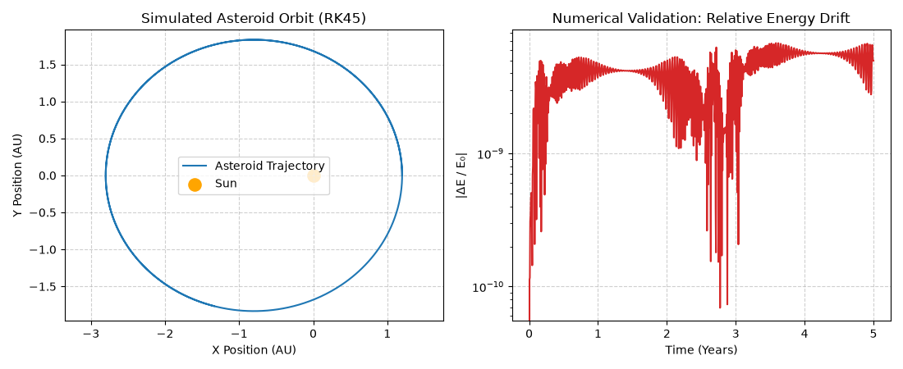

# Asteroid-Orbital-Dynamics

# Asteroid Orbital Dynamics & Numerical Validation

A 2D orbital mechanics simulation built in Python to model heliocentric asteroid

## Physics & Numerical Approach
* **Equations of Motion:** Models Newtonian two-body gravitational acceleration in astronomical units ($\text{AU}^3 / \text{yr}^2$).
* **Initial Conditions:** Initializes an eccentric asteroid orbit ($e = 0.4$) at perihelion ($r_0 = 1.2\text{ AU}$) via the vis-viva equation.
* **Solver Validation:** Integrates state vectors over a 5-year window with tight relative and absolute tolerances (`rtol=1e-9`, `atol=1e-9`), tracking relative specific orbital energy drift ($|\Delta E / E_0|$) to confirm numerical stability.

## Simulation Output

## Dependencies
* `numpy`
* `scipy`
* `matplotlib`
